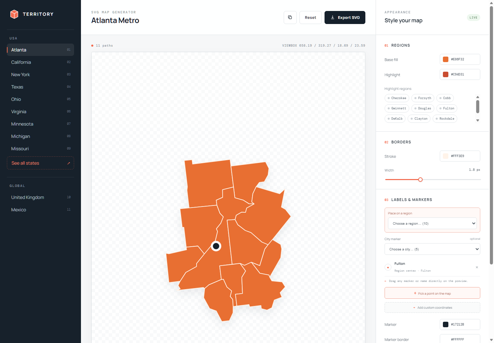

<div align="center">

# Territory SVG Map Generator

**Design regional maps in the browser and export clean, standalone SVGs.**

[](./LICENSE)


</div>

<p align="center">
  
</p>

Territory is a visual editor and reusable local generator for producing custom SVG maps. Pick a supported territory, choose its regions, style fills and borders, highlight selected areas, place markers or names, then export an SVG that works directly in HTML, CSS, design tools, or any static site.

The exported file has a transparent background, an automatically cropped `viewBox`, and a separate `<path>` for every region. It needs no mapping library at runtime.

## What it can do

- Generate county-level maps for US state presets.
- Generate custom multi-state US maps.
- Generate subdivision maps for the United Kingdom and Mexico.
- Highlight any number of counties, states, or regions.
- Add markers at a region's generated center without entering coordinates.
- Add built-in city markers, latitude/longitude markers, or points picked directly on the map.
- Render markers as a **dot**, **name only**, or **dot + name**.
- Control map fill, highlight, border, marker, marker outline, and text outline colors.
- Control border widths and marker/text size down to `0.25`.
- Drag markers and labels directly in the preview before export.
- Export or copy a self-contained SVG with no runtime dependencies.

## Supported presets

| Territory | Detail level |
| --- | --- |
| Atlanta | 11 metro counties |
| California | 58 counties |
| New York | 62 counties |
| Texas | 254 counties |
| Ohio | 88 counties |
| Virginia | Counties and independent cities |
| Minnesota | 87 counties |
| Michigan | 83 counties |
| Missouri | 114 counties plus St. Louis |
| See all US states | State-level paths |
| United Kingdom | England, Scotland, Wales, and Northern Ireland |
| Mexico | 32 first-level administrative regions |

## Quick start

Node.js 18 or newer is recommended. The editor itself has no package dependencies, so there is nothing to install.

```bash
npm run dev
```

Open [http://localhost:4173](http://localhost:4173), select a preset, and start styling. When the map is ready, use **Download SVG** or **Copy SVG**.

## Build a portable version

```bash
npm run build
```

The build is written to `dist/` as only three files:

```text
dist/
├── index.html
├── styles.css
└── bundle.js
```

Open `dist/index.html` directly with `file://`, upload the folder to any static host, or deploy it to GitHub Pages, Vercel, Netlify, or Cloudflare Pages. No Node server, ES module loader, or mapping library is required after the build.

## Generate maps from JSON

The visual editor is convenient for one-off work. For repeatable maps, use a config file:

```json
{
  "mode": "counties",
  "state": "Georgia",
  "title": "Atlanta Metro Counties",
  "counties": ["Cherokee", "Forsyth", "Cobb", "Gwinnett", "Fulton", "DeKalb"],
  "highlightedCounties": ["Fulton"],
  "regionMarkers": ["Fulton"],
  "cities": [
    { "name": "Atlanta", "latitude": 33.749, "longitude": -84.388, "mode": "dot-name" }
  ],
  "padding": 1.2,
  "output": "atlanta-region-map.svg",
  "style": {
    "fill": "#e86f32",
    "highlightFill": "#c94d31",
    "border": "#fff3e9",
    "borderWidth": 1.8,
    "marker": "#17212b",
    "markerBorder": "#ffffff",
    "markerBorderWidth": 0.4,
    "markerRadius": 0.6,
    "markerMode": "dot"
  }
}
```

Then run:

```bash
node scripts/generate-map.mjs --config configs/your-map.json
```

Included examples:

```bash
npm run generate:atlanta
npm run generate:uk
npm run generate:mexico
```

You can also override common values from the command line:

```bash
node scripts/generate-map.mjs \
  --config configs/atlanta-region.json \
  --counties "Fulton,DeKalb,Cobb,Gwinnett" \
  --highlight "Fulton" \
  --mark-regions "Fulton,DeKalb" \
  --city "Atlanta,33.749,-84.388" \
  --output atlanta-core.svg
```

On PowerShell, place the command on one line or replace each trailing `\` with a backtick.

## SVG output

Generated SVGs are ready to use as regular image files:

```html

```

They can also be pasted inline for CSS styling or imported into Figma. Every geographical unit remains independently selectable because it is exported as its own path.

The repository includes three generated examples:

- [`atlanta-region-map.svg`](./atlanta-region-map.svg)
- [`uk-regions-map.svg`](./uk-regions-map.svg)
- [`mexico-regions-map.svg`](./mexico-regions-map.svg)

## Project structure

```text
configs/             Reusable map recipes
docs/                README assets
scripts/build.mjs    Portable browser build
scripts/generate-map.mjs
                     Config and CLI SVG generator
src/app.js           Visual editor behavior
src/map-data.js      Pre-generated SVG path data
src/projections.js   Projection helpers
tests/verify.mjs     Output and structure checks
```

## Scripts

| Command | Purpose |
| --- | --- |
| `npm run dev` | Start the local editor on port 4173 |
| `npm run build` | Create the portable `dist/` build |
| `npm run generate:atlanta` | Generate the Atlanta example |
| `npm run generate:uk` | Generate the UK example |
| `npm run generate:mexico` | Generate the Mexico example |
| `npm run generate:data` | Rebuild static geometry data |
| `npm test` | Check source syntax and generated output |

## Updating geometry data

D3, TopoJSON, and atlas packages are generation tools only. They are intentionally kept outside the root `package.json`:

```bash
npm install --prefix .map-tools --no-save d3-geo@3 topojson-client@3 us-atlas@3 world-atlas@2
npm run generate:data
```

The temporary `.map-tools/` directory is ignored by Git. Production code reads plain pre-generated path data from `src/map-data.js`.

## Data sources

- US state and county geometry: [topojson/us-atlas](https://github.com/topojson/us-atlas)
- Base world geometry tooling: [topojson/world-atlas](https://github.com/topojson/world-atlas)
- United Kingdom and Mexico ADM1 boundaries: [geoBoundaries gbOpen](https://www.geoboundaries.org/)

Global SVG exports include attribution metadata for their source geometry.

## License

Released under the [MIT License](./LICENSE).
